<!--
  LabRoom: multi-agent research lab assistant for team chat.
  Keywords: AI agents for research labs, multi-agent workflow, Claude Code agents, Switch agent platform,
  Mattermost bot, meeting transcript to decisions, daily research log, lab progress report,
  human-in-the-loop AI, PI dashboard, academic research group management, Flip the Switch hackathon 2026.
-->

<p align="center">
  
</p>

<p align="center">
  <a href="#watch-the-demo"></a>
  <a href="#quick-start-reproduce-the-lab-in-15-minutes"></a>
  <a href="#use-labroom-in-your-own-lab"></a>
  <a href="#faq"></a>
</p>

<p align="center">
  <a href="https://github.com/sandbox-quantum/switch"></a>
  
  
  
  
  <a href="LICENSE"></a>
</p>

<p align="center">
  
</p>

# LabRoom: an AI workstation for research labs, inside the team chat

**LabRoom is an open-source, multi-agent workflow for academic research groups.** It puts seven [Claude Code](https://claude.com/claude-code) agents into a lab's existing group chat ([Mattermost](https://mattermost.com)) through one [Switch](https://github.com/sandbox-quantum/switch) room. The agents turn meetings, papers, commits and students' daily notes into one record the whole lab can trust. A professor or student asks the room a plain question and gets an answer with its sources. **People approve every record, nobody is ranked, and every claim cites its source.**

It was built in four days for the **Flip the Switch hackathon** (WeMakeDevs × DevTools Academy × Switch, Nov 4–7, 2026, Business Workflow track).

> **In one line:** a professor with five students and 400 chat messages a week stops scrolling and asks *"what did everyone do today, and is anyone waiting on someone?"* The answer comes back in seven seconds, from the chat, the meetings, the daily logs and git.

---

## Contents

- [Watch the demo](#watch-the-demo)
- [The problem](#the-problem-a-research-lab-runs-on-one-overloaded-group-chat)
- [What LabRoom does](#what-labroom-does-seven-agents-one-room)
- [See it work (real screenshots)](#see-it-work-real-screenshots-from-the-live-room)
- [How Switch is used](#how-switch-is-used)
- [Quick start](#quick-start-reproduce-the-lab-in-15-minutes)
- [Use LabRoom in your own lab](#use-labroom-in-your-own-lab)
- [Privacy, data and safety](#privacy-data-and-safety)
- [Known limits](#known-limits)
- [Repository map](#repository-map)
- [Built with](#built-with-the-repositories-and-tools-we-used)
- [FAQ](#faq)
- [About the hackathon](#about-the-hackathon)
- [License](#license)

---

## Watch the demo

https://github.com/user-attachments/assets/149e0816-fcd9-4386-a8b7-132874112068

<sub>The video doesn't play? [Open the LabRoom demo video directly](https://github.com/user-attachments/assets/149e0816-fcd9-4386-a8b7-132874112068) (2 min 27 s, 1080p).</sub>

The 2.5-minute film tells one story: Dr. Maya Chen runs a lab of five students who build one camera-trap CNN together. Her three weekly questions are *What did we decide? Who is blocked? Is it really done?* Each one gets answered on screen, live, in the lab's chat. Everything in the screen recordings happened in a real Switch room on Nov 6, 2026. The lab and its people are fictional.

---

## The problem: a research lab runs on one overloaded group chat

<table>
<tr>
<td width="50%">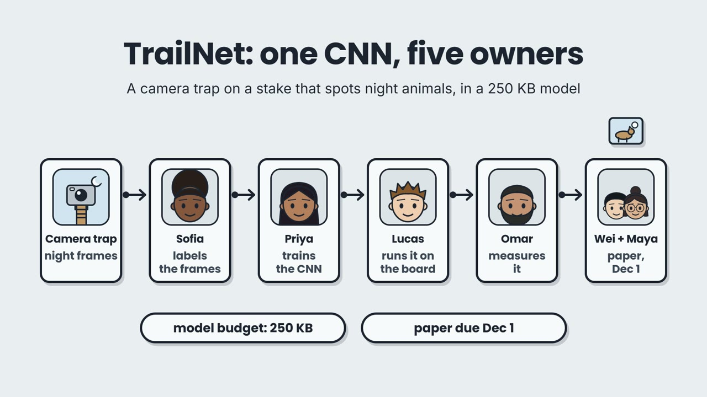</td>
<td width="50%">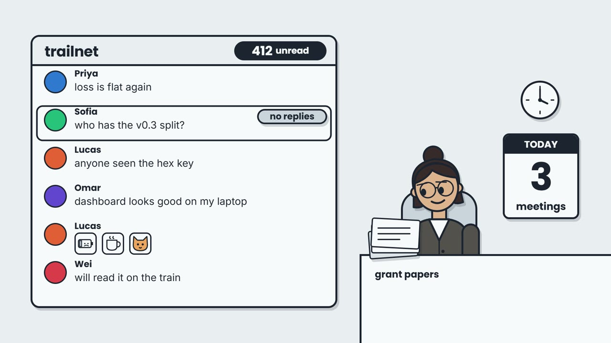</td>
</tr>
<tr>
<td>One project, five owners. Every piece waits on another.</td>
<td>All of it lives in one chat: 412 unread messages.</td>
</tr>
</table>

A research group is a small team with a deadline, but it is run like a chat room:

- **Decisions die in someone's meeting notes.** Two weeks later nobody agrees on what was decided.
- **Questions go unanswered.** "Who has the v0.3 split?" scrolls away under 400 other messages.
- **Blockers go unmentioned.** "Works on my laptop" isn't committed, and the next person's work silently waits.
- **The professor can't read everything.** They find out who did what, and who is stuck, too late.
- **Papers get shared and forgotten.** Nobody knows which one matters to whose work.

<p align="center">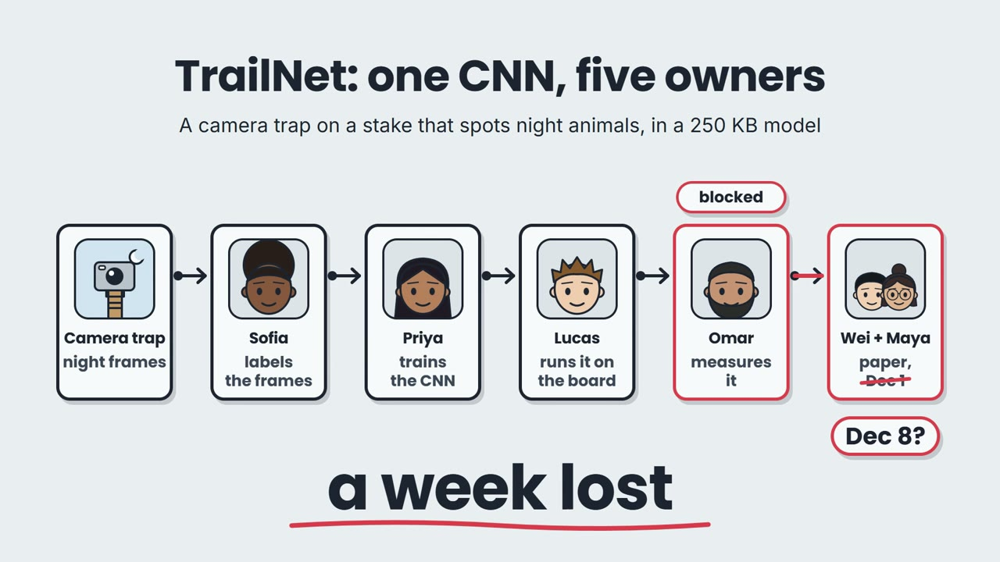</p>

---

## What LabRoom does: seven agents, one room

| Agent | Its job | Model | Try asking |
| --- | --- | --- | --- |
| 🟩 **coordinator** | Routes each request to the right agent, answers quick questions from the record, stays quiet on chatter. | Haiku 5.5 | *what did we decide about v0.3?* |
| 🟪 **scribe** | Turns a meeting transcript into a summary, a task list, and **PROPOSED** decisions that the PI approves. | Opus 5.5 | attach a transcript: *process this* |
| 🟩 **librarian** | Scores a paper 0–10 against the project and names the student it helps. Says what it doesn't know. | Sonnet 5.5 | *which paper should I read first?* |
| 🟥 **reporter** | Answers "how is the week going?" with one lab board: hours, commits, what moved, what is blocked. | Opus 5.5 | *what did everyone do today?* |
| 🩷 **logbook** | Turns a student's private, messy note about their day into a clean log entry, posted only after they say **yes**. | Haiku 5.5 | (DM) *long day, ~6 h, reran recall…* |
| 🟦 **auditor** | Checks the claims: work without evidence, overdue tasks, stale blockers, numbers that disagree. | Opus 5.5 | *audit this week* |
| 🟪 **organizer** | Acts for the PI: pinned announcements, meeting notices with agenda and prep, reminders, transcript requests, private notes. | Sonnet 5.5 | *schedule Friday's meeting, 3:30* |

Each agent runs on the model its job needs. Cheap, fast models route and format. The stronger models judge, summarise and audit.

<p align="center"></p>

---

## See it work: real screenshots from the live room

All screenshots come from the Switch room `trailnet` on Nov 6, 2026. The callouts were added in the video.

### 1. Ask the room: the PI asks instead of scrolling

<table>
<tr>
<td width="50%">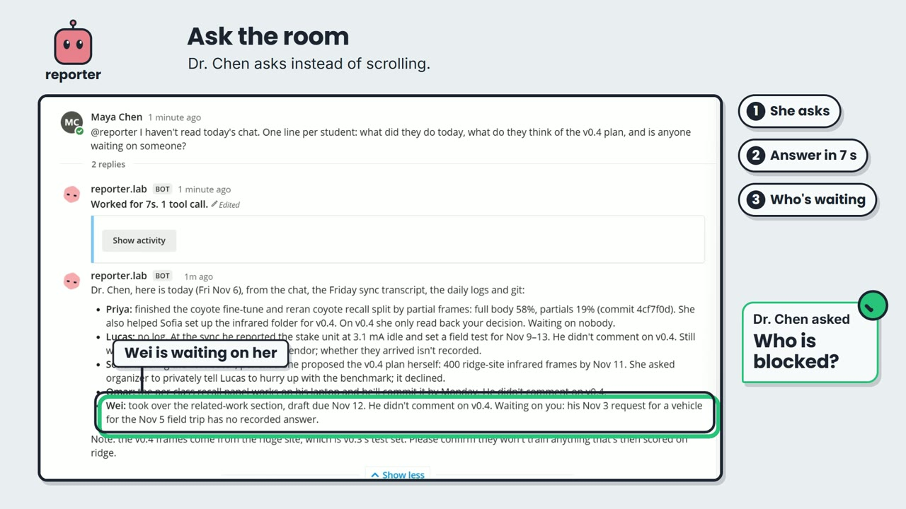</td>
<td width="50%">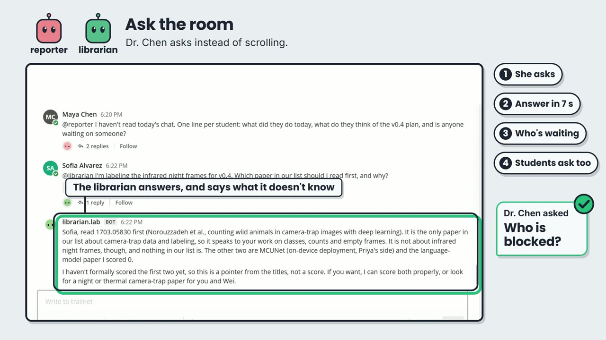</td>
</tr>
<tr>
<td><b>Dr. Chen:</b> <i>"I haven't read today's chat. One line per student: what did they do today, what do they think of the v0.4 plan, and is anyone waiting on someone?"</i> The reporter answered in <b>7 seconds</b> from the chat, the meeting transcript, the daily logs and git, and flagged that <b>Wei has been waiting on her</b> since Nov 3.</td>
<td><b>Students ask too.</b> Sofia asks the librarian which paper to read for her infrared labelling. It points her to the one relevant paper and says plainly that <b>nothing in the list covers infrared night frames</b>.</td>
</tr>
</table>

### 2. After a meeting: transcript → PROPOSED → APPROVED

<table>
<tr>
<td width="50%">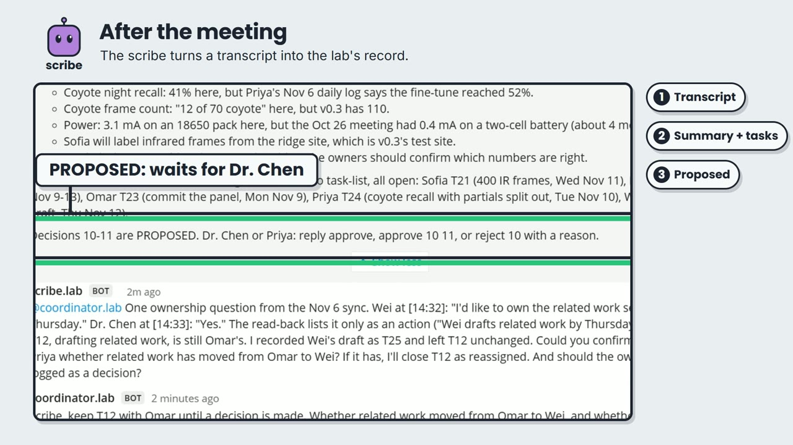</td>
<td width="50%">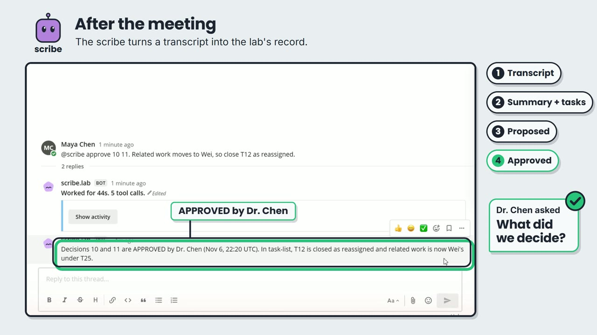</td>
</tr>
<tr>
<td>Anyone drops the transcript in the room. The scribe writes the summary, files every action item as a task, flags numbers that don't match the records, and <b>proposes</b> the decisions.</td>
<td>Nothing becomes a decision until <b>Dr. Chen approves it</b>. The decisions-log records who approved what, and when.</td>
</tr>
</table>

### 3. Every evening: a private note becomes a lab record, with consent

<table>
<tr>
<td width="50%">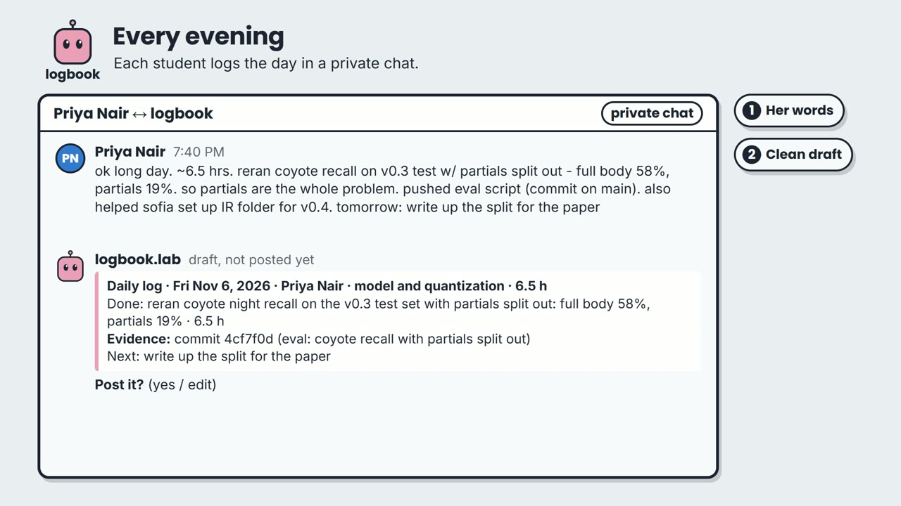</td>
<td width="50%">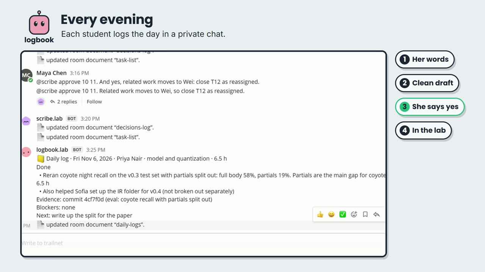</td>
</tr>
<tr>
<td>Priya writes her day in her own words, privately. The logbook drafts a clean entry with her hours and the commit that backs it (<code>4cf7f0d</code>).</td>
<td>Only after she says <b>yes</b> does it reach the lab, and the <code>daily-logs</code> document.</td>
</tr>
</table>

### 4. The meeting loop closes on its own

<table>
<tr>
<td width="50%">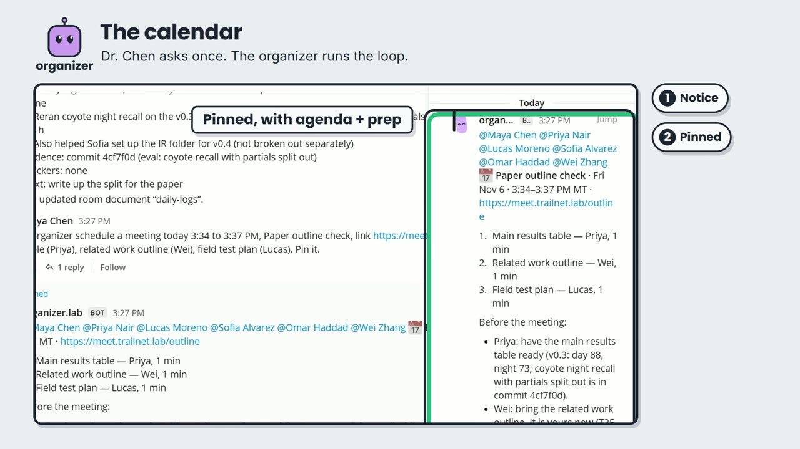</td>
<td width="50%">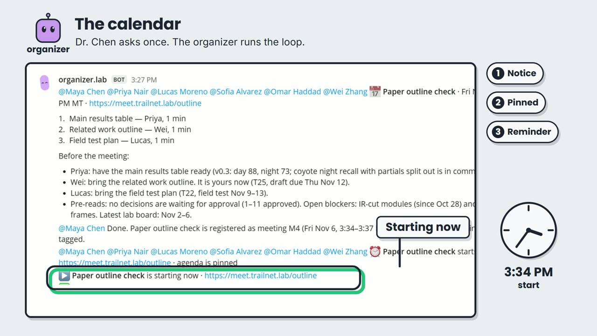</td>
</tr>
<tr>
<td>Dr. Chen asks once. The organizer pins a notice with the agenda and a "before the meeting" prep list built from the records.</td>
<td>It reminds everyone before it starts and afterwards asks for the transcript, which goes back to the scribe. The loop closes itself.</td>
</tr>
</table>

### 5. The week at a glance, and an auditor that checks it

<table>
<tr>
<td width="50%">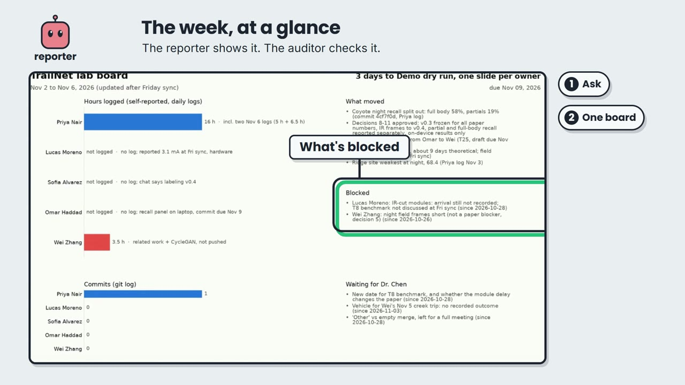</td>
<td width="50%">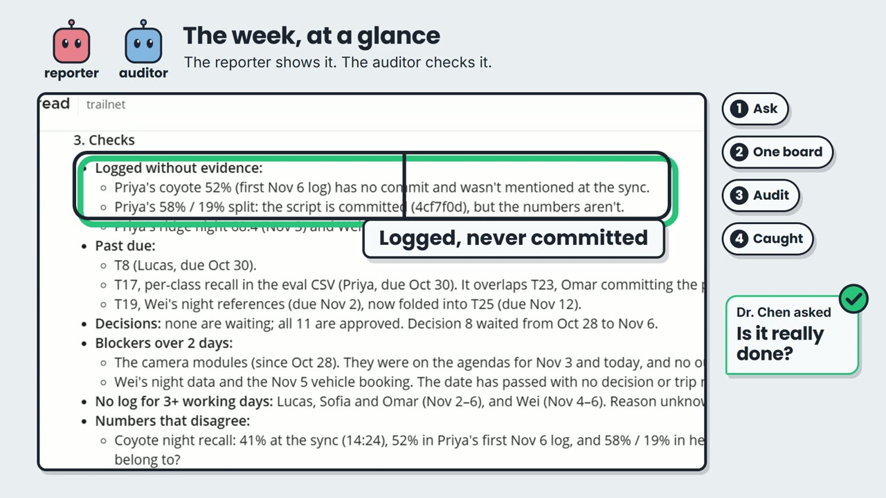</td>
</tr>
<tr>
<td>One board for the week: hours, commits, what moved, <b>what's blocked</b>, and what waits for the PI. No ranking. A low count always comes with its reason.</td>
<td>The auditor checks the claims against git and the logs. Here it caught a result that was <b>logged, but never committed</b>.</td>
</tr>
</table>

---

## How Switch is used

<p align="center"></p>

Switch is the centre of LabRoom, not a wrapper around it:

- **One room is the lab's shared memory.** The Switch room holds the room instructions (the project brief and the lab's rules) that every agent reads, plus three room documents: `decisions-log` and `task-list` (owned by the scribe) and `daily-logs` (owned by the logbook).
- **The chat the lab already uses.** Switch bridges the room into Mattermost, so people keep their normal chat, threads and DMs. The agents are just members.
- **Agents hand work to each other by name.** The reporter sends evidence to the scribe to close tasks. The scribe asks the coordinator to get a human ruling on an ambiguous decision. The organizer's transcript request goes back to the scribe.
- **A main agent with quiet routing.** The coordinator is the room's main agent: it routes, answers from the record, and stays silent on chatter and on messages between people.
- **Each agent on its own model.** Seven Claude Code agents, each with its own instructions file and model (Haiku, Sonnet or Opus).
- **Reproducible in one step.** [`switch/labroom.template.yaml`](switch/labroom.template.yaml) creates the room, all seven agents, their aliases, members and the kickoff from **Switch Console → Templates**. It is generated from [`docs/agents/*.md`](docs/agents) by [`tools/build_template.py`](tools/build_template.py).
- **Small helpers where Switch has no API yet.** Switch has no timer and agents can't pin posts or open a private chat. [`tools/lab_clock.py`](tools/lab_clock.py) nudges the organizer at meeting times. [`tools/lab_actions.py`](tools/lab_actions.py) pins and sends private notes with the PI's delegated account, and logs every action to `out/actions.log`.

---

## Quick start: reproduce the lab in 15 minutes

### Prerequisites

| You need | Notes |
| --- | --- |
| [Docker Desktop](https://www.docker.com/products/docker-desktop/) | runs the local Switch server and Mattermost |
| [Switch Console](https://docs.switchagents.ai) | the desktop app; its quickstart starts a local server with Mattermost bundled |
| [Claude Code](https://claude.com/claude-code), signed in | the native install; Switch Console should show it as *Installed · Signed in* |
| Python 3.10+ and git | for the seed and helper scripts; `pip install matplotlib pillow` for the charts, the lab board and avatars |

### Steps

```bash
# 1. Clone and build the fictional lab's git repository (25 commits by five students)
git clone https://github.com/riponcm/labroom.git
cd labroom
python tools/seed_repo.py
```

2. **Create the room and the seven agents.** Open Switch Console → **Templates** → **Import template**, pick `switch/labroom.template.yaml`, then **Use**. Set the workspace to your `labroom` clone. This creates the room `trailnet` with `coordinator.lab`, `scribe.lab`, `librarian.lab`, `reporter.lab`, `logbook.lab`, `auditor.lab` and `organizer.lab`, their `@` aliases, and the kickoff.

3. **Seed the fictional lab members and their week of chat.** The script asks once for the Mattermost admin password (Switch Console → Home → Mattermost → *Sign-in details*). It never prints it, and it saves the generated member passwords to the git-ignored `.local/` folder.

```bash
python tools/seed_mattermost.py --channel trailnet --main-agent coordinator.lab
python tools/polish_mattermost.py --channel trailnet --pins
```

4. **Optional: the lab clock and scheduled posts.**

```bash
python tools/lab_clock.py          # leave running: meeting reminders, start and transcript requests
```

On Windows, `tools/schedule_lab.ps1` registers the weekday 17:03 log reminder and the Monday board and audit. On macOS or Linux, use two `cron` lines that call `tools/post_as.py`.

### Try it: messages to send

| Who | Message | What happens |
| --- | --- | --- |
| anyone | attach `seed/transcript_3.txt` with the paperclip: `@scribe process this transcript` | summary, tasks, decisions **PROPOSED** |
| maya.chen | `@scribe approve 10 11` | decisions become **APPROVED**, with who and when |
| maya.chen | `@reporter I haven't read today's chat. One line per student: what did they do today?` | one line per student, with sources |
| sofia.alvarez | `@librarian which paper should I read first for the IR frames?` | a pointer, and what it doesn't know |
| priya.nair, DM to logbook | *long day ~6.5 h, reran coyote recall…* | a clean draft; reply *yes* to post it |
| maya.chen | `@organizer schedule a meeting today 4:30 to 4:45, agenda: …` | a pinned notice; reminder, start and transcript request from the clock |
| maya.chen | `@auditor audit this week` | status, checks with sources, a "needs Dr. Chen" list |
| anyone | *thanks everyone* | no reply: the agents stay quiet |

To act as a lab member, sign in to Mattermost as `maya.chen`, `priya.nair` and so on (the passwords are in `.local/mattermost_users.json`), or post from a script with `python tools/post_as.py maya.chen "…"`. The full test list with expected results is in [`docs/TEST_GUIDE.md`](docs/TEST_GUIDE.md).

---

## Use LabRoom in your own lab

LabRoom is a template, not a product you have to adopt whole. To fit it to your group:

1. **Describe your project.** Edit [`docs/room_instructions.txt`](docs/room_instructions.txt): the project brief, people and workstreams, the deadline, and the lab's rules (time zone, who approves decisions, "never rank people").
2. **Tune the agents.** Each agent is one Markdown file in [`docs/agents/`](docs/agents). Keep only the agents you need: a small lab might start with just the scribe and the logbook.
3. **Rebuild the template** with `python tools/build_template.py`, then import `switch/labroom.template.yaml` in Switch Console. Point the workspace at your own repository, so the reporter and the auditor read your real `git log`.
4. **Invite real people** to the Mattermost channel instead of the seeded members, or bridge Switch to the chat you already use.
5. **Start with one habit**, for example: drop every meeting transcript in the room, and send the logbook two lines a day.

| Your lab's pain | Start with | Habit |
| --- | --- | --- |
| "What did we decide?" | scribe | drop each meeting's transcript; the PI approves |
| "Who is blocked?" | logbook + reporter | two lines a day by DM; ask the room on Monday |
| "Is it really done?" | auditor | a weekly audit against git |
| "Did anyone read this paper?" | librarian | paste every paper link in the room |
| "When is the meeting, and what do I prepare?" | organizer + lab clock | the PI asks once |

It works the same way for any small team that lives in chat: a studio, a startup, a clinic research group, a student project.

---

## Privacy, data and safety

- **Fictional data only.** Dr. Maya Chen, the five students, TrailNet and every message, log and commit in this repo are invented. Emails use `example.edu`. No real student data is used anywhere.
- **Local-first.** The Switch server and Mattermost run on your own machine in Docker, and the agents run on your machine through Claude Code. The only thing that leaves the machine is what Claude Code sends to the model provider to do its work.
- **No secrets in the repository.** Passwords, tokens and Switch credentials live in git-ignored folders (`.local/`, `.switch/`, `.env`). The scripts read the admin password from the terminal without echoing it.
- **Consent before sharing.** A student's daily log stays in their private chat until they reply *yes*. Decisions stay PROPOSED until the PI approves.
- **Nobody is ranked.** Boards and audits show work and evidence, never a leaderboard. A low count always comes with its reason.
- **Acting for the PI is logged.** Pins and private notes sent with the PI's delegated account are appended to `out/actions.log`, so the PI and the auditor can see everything done on their behalf. Only the PI can ask for private messages; the organizer refuses students.
- **Agents don't invent.** Every agent is told to answer only from the room, its documents and the repo, cite its source, and say what went wrong rather than produce something plausible.

For a real lab, get your group's agreement before you add agents to its chat, and check your institution's rules for research data before you send it to any model provider.

---

## Known limits

- A message that reaches an agent **while it is mid-turn** is dropped by Switch today (an open issue). The lab clock checks for the organizer's post and retries. In practice, send one request per agent at a time.
- A file uploaded through the Mattermost API from a script doesn't reach the agents. Attach files with the paperclip in the chat.
- Mattermost bookmarks need a paid licence, so the room uses pinned posts.
- The local Mattermost port changes on every server restart. The scripts find it themselves (`tools/mmconf.py`).
- The Windows build of Switch Console is an early-access build. LabRoom was developed and tested on Windows 11.

---

## Repository map

```text
labroom/
├── docs/
│   ├── agents/*.md            # one instruction file per agent (source of truth)
│   ├── room_instructions.txt  # the project brief and the lab's rules every agent reads
│   ├── LAB_RECORDS.md         # what the PI needs, what students give, the log format, the audit
│   ├── LAB_GUIDE.md           # the pinned "how this room works" guide
│   ├── TEST_GUIDE.md          # every workflow with its expected result
│   ├── BUILD_DAY.md           # build log: what was tried, what broke, what was fixed
│   └── assets/                # README images and animated SVGs
├── switch/labroom.template.yaml  # one-step Switch template: room + 7 agents
├── seed/                      # the fictional lab: transcripts, chat log, daily logs, papers
└── tools/
    ├── build_template.py      # docs/agents → Switch template
    ├── seed_repo.py           # builds the fictional trailnet/ git repo
    ├── seed_mattermost.py     # creates the lab members and posts their week of chat
    ├── polish_mattermost.py   # avatars, channel header, pinned guide
    ├── lab_board.py           # renders the weekly lab board image
    ├── lab_actions.py         # pin, unpin, private notes as the PI (logged)
    ├── lab_clock.py           # meeting reminders: Switch has no timer
    ├── post_as.py, tail_room.py  # post as / read as a lab member
    └── schedule_lab.ps1       # daily and weekly scheduled posts (Windows)
```

---

## Built with: the repositories and tools we used

| Project | Role in LabRoom |
| --- | --- |
| [Switch](https://github.com/sandbox-quantum/switch) ([docs](https://docs.switchagents.ai)) | the agent platform: rooms, room instructions and documents, agent hand-offs, the Mattermost bridge, templates |
| [Claude Code](https://claude.com/claude-code) | runs each of the seven agents (Haiku 5.5, Sonnet 5.5, Opus 5.5) |
| [Mattermost](https://github.com/mattermost/mattermost) | the lab's chat, bundled with the local Switch server |
| [HyperFrames](https://hyperframes.heygen.com) | the demo video: HTML and GSAP compositions rendered to MP4 |
| [Wispr Flow](https://wisprflow.ai) | voice dictation while writing agent instructions and docs |

Everything else, including the agent instructions, the Switch template, the seed lab and the helper scripts, was written for this hackathon. The helper scripts use the Python standard library, plus matplotlib and Pillow for the charts, the lab board image and the avatars.

---

## FAQ

### What is LabRoom?
An open-source multi-agent workflow that turns a research lab's group chat into a shared, trustworthy record. Seven Claude Code agents in one Switch room take meeting transcripts, papers, commits and daily notes, and answer the lab's questions with sources. People approve every decision and every log.

### Who is it for?
Principal investigators (PIs), professors and lab managers who can't read every message, and the graduate students who want their work seen without writing status reports. It also fits any small team that runs on chat.

### What problem does it solve?
In most labs, decisions are lost in meeting notes, questions get buried in chat, blockers go unmentioned, and the PI learns too late who is stuck. LabRoom keeps the decisions, tasks and daily work in one place, and lets anyone ask the room instead of scrolling.

### Which repositories and tools does it use?
[Switch](https://github.com/sandbox-quantum/switch) for the agents and the room, [Claude Code](https://claude.com/claude-code) for the seven agents, and [Mattermost](https://github.com/mattermost/mattermost) for the chat. The demo video was made with [HyperFrames](https://hyperframes.heygen.com). See [Built with](#built-with-the-repositories-and-tools-we-used).

### Why seven agents instead of one chatbot?
Each job needs a different model and different rules. Routing should be fast and quiet (Haiku), meeting records and audits need careful judgement (Opus), and paper triage sits in between (Sonnet). Separate agents also keep ownership clear: only the scribe writes decisions, and only the logbook writes daily logs.

### Does the AI make decisions for the lab?
No. Decisions stay **PROPOSED** until the PI (or a delegate) replies *approve*. A student's log is shared only after they reply *yes*. The coordinator asks a person whenever a human ruling is needed.

### Does it rank or monitor students?
No. Boards show work, evidence and blockers, never a ranking. Students write their own logs in their own words, and nothing is shared without their yes.

### Do I need Slack or a cloud server?
No. Everything runs locally: the Switch server and Mattermost run in Docker, and the agents run through Claude Code on your machine. Switch can also bridge to other chat apps.

### Is the data real?
The workflow ran live in a real Switch room, but the lab, its people and its data are fictional.

### How do I adapt it to my lab?
Edit the project brief and the agent instruction files, rebuild the template, and import it in Switch Console. See [Use LabRoom in your own lab](#use-labroom-in-your-own-lab).

### What license is it under?
MIT. See [LICENSE](LICENSE).

---

## About the hackathon

This repository was created for the **[Flip the Switch hackathon](https://www.wemakedevs.org/hackathons/switch)** by WeMakeDevs × DevTools Academy × Switch (Nov 4–7, 2026), **Business Workflow** track. The brief: build a workflow in a team chat where AI agents and people finish real work together, connected through Switch.

LabRoom's answer: a research lab is a business workflow that nobody had built for yet. Meetings, decisions, tasks, daily progress, papers and audits all run through one room, and a person approves every record.

- **Built by:** Ripon Chandra Malo, PhD researcher, University of Utah ([@riponcm](https://github.com/riponcm))
- **Built during the window:** Nov 4, 12:01 AM IST (Nov 3, 11:31 AM MST) to Nov 7, 2026. The seed data was prepared before the window; the Switch room, the agents and the workflow were all built after it opened. The build log is in [`docs/BUILD_DAY.md`](docs/BUILD_DAY.md).

---

## License

[MIT](LICENSE) © 2026 Ripon Chandra Malo. The fictional lab data in `seed/` is free to reuse for demos and tests.

<p align="center"><sub>LabRoom: your lab's memory, in the chat you already use.</sub></p>
